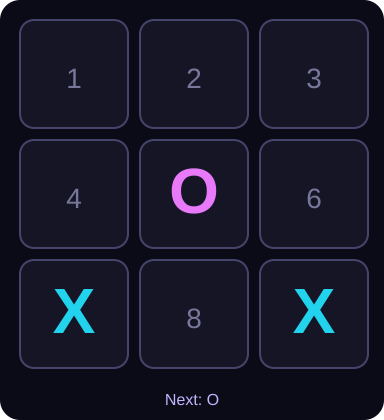

<picture>
  <source media="(prefers-color-scheme: light)" srcset="https://YOUR-VERCEL-APP.vercel.app/api/banner?user=SKY-Apocalypse&theme=light"/>
  <source media="(prefers-color-scheme: dark)" srcset="https://YOUR-VERCEL-APP.vercel.app/api/banner?user=SKY-Apocalypse&theme=dark"/>
  
</picture>

> The banner selects a random palette from the current India-season theme, includes IST time, adapts to GitHub light/dark mode, and animates a floating smiley. GitHub may cache externally hosted images, so colour changes on every refresh are best-effort.

---

## `whoami` — About Me

Hey, I'm **Sankalp Pandey** — an engineering student and curious builder who enjoys exploring technology, experimenting with ideas, and learning by making things.

- 🔭 Exploring software development, Linux and open-source workflows
- 🌱 Currently learning backend development and strengthening programming fundamentals
- 🧪 Turning concepts into practical projects and learning from the process
- 🎯 Interested in problem-solving, developer tools and useful digital experiences

> Curious builder — exploring technology, learning through projects and experimenting with ideas.

## ⚙️ Tech Stack

**Languages**

**Web & Data**

**Tools & Environment**

*Backend development is currently a learning focus.*

## 🕹️ Live Arcade — Community Tic-Tac-Toe

Make a move in the shared GitHub game. Each square opens a pre-filled GitHub Issue; GitHub Actions validates the move, updates the board and comments with the result.

**Choose a square:**

| | | |
|:---:|:---:|:---:|
| [1](https://github.com/SKY-Apocalypse/SKY-Apocalypse/issues/new?title=Arcade%20move%20-%20Square%201&body=MOVE%3A%200) | [2](https://github.com/SKY-Apocalypse/SKY-Apocalypse/issues/new?title=Arcade%20move%20-%20Square%202&body=MOVE%3A%201) | [3](https://github.com/SKY-Apocalypse/SKY-Apocalypse/issues/new?title=Arcade%20move%20-%20Square%203&body=MOVE%3A%202) |
| [4](https://github.com/SKY-Apocalypse/SKY-Apocalypse/issues/new?title=Arcade%20move%20-%20Square%204&body=MOVE%3A%203) | [5](https://github.com/SKY-Apocalypse/SKY-Apocalypse/issues/new?title=Arcade%20move%20-%20Square%205&body=MOVE%3A%204) | [6](https://github.com/SKY-Apocalypse/SKY-Apocalypse/issues/new?title=Arcade%20move%20-%20Square%206&body=MOVE%3A%205) |
| [7](https://github.com/SKY-Apocalypse/SKY-Apocalypse/issues/new?title=Arcade%20move%20-%20Square%207&body=MOVE%3A%206) | [8](https://github.com/SKY-Apocalypse/SKY-Apocalypse/issues/new?title=Arcade%20move%20-%20Square%208&body=MOVE%3A%207) | [9](https://github.com/SKY-Apocalypse/SKY-Apocalypse/issues/new?title=Arcade%20move%20-%20Square%209&body=MOVE%3A%208) |

- Players alternate X and O; first accepted move is X.
- The board is shared by all visitors.
- Occupied squares and moves after a win/draw are rejected.
- Repository owner can reset by opening an issue with exact body `RESET GAME`.
- This is turn-based, not real-time multiplayer; issue and workflow processing may take a short time.

## 📡 Developer Dashboard

<table>
<tr>
<td width="50%" valign="top">

**GitHub telemetry**

</td>
<td width="50%" valign="top">

**Developer RPG**

**Skill tree:** C++ · C · Python · JavaScript · HTML · CSS · React · MongoDB · Linux · Git · Bash · Figma

XP is not fabricated from profile views or commits. An achievement-based XP system can be added later.

</td>
</tr>
</table>

### 🎧 Now Playing

Spotify is not connected yet. Add your deployed Spotify widget URL here when available.

## 🐍 Contribution Trail

<picture>
  <source media="(prefers-color-scheme: dark)" srcset="https://raw.githubusercontent.com/SKY-Apocalypse/SKY-Apocalypse/output/github-contribution-grid-snake-dark.svg"/>
  <source media="(prefers-color-scheme: light)" srcset="https://raw.githubusercontent.com/SKY-Apocalypse/SKY-Apocalypse/output/github-contribution-grid-snake.svg"/>
  
</picture>

## 🚀 Featured Projects

| Project | What I'm exploring |
|---|---|
| [HSC CS Notes](https://github.com/SKY-Apocalypse?tab=repositories) | Learning resources and interactive notes for computer science students |
| [Linux Job Scheduler](https://github.com/SKY-Apocalypse?tab=repositories) | Linux scheduling, cron workflows and multi-developer integration |
| [String Encoder / Decoder](https://github.com/SKY-Apocalypse?tab=repositories) | Shell scripting, string processing and file handling |
| [New Year Fireworks](https://github.com/SKY-Apocalypse?tab=repositories) | Interactive web animation and front-end experimentation |

*Project links currently lead to your repositories list. Replace with exact project URLs when confirmed.*

## 🤝 Connect

<!-- Add LinkedIn and email after sharing those details. -->

**Thanks for visiting — keep exploring, keep building.** ✨

